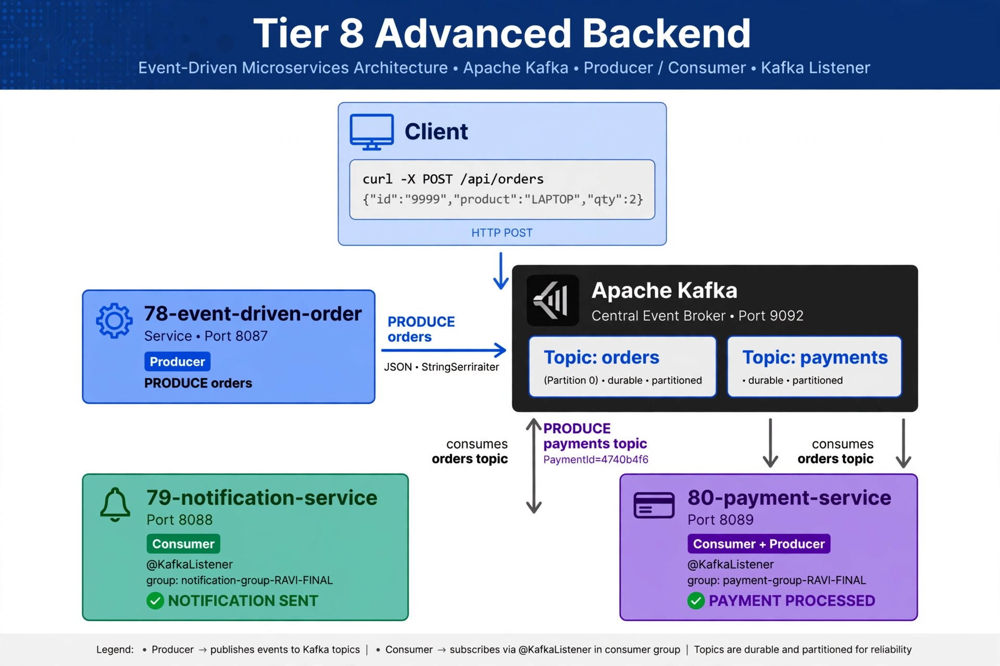
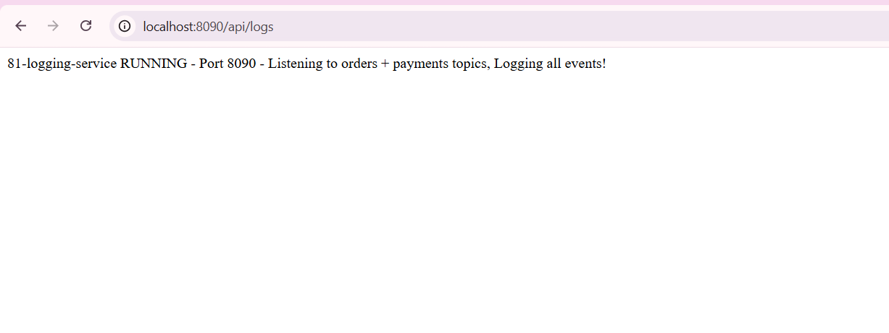
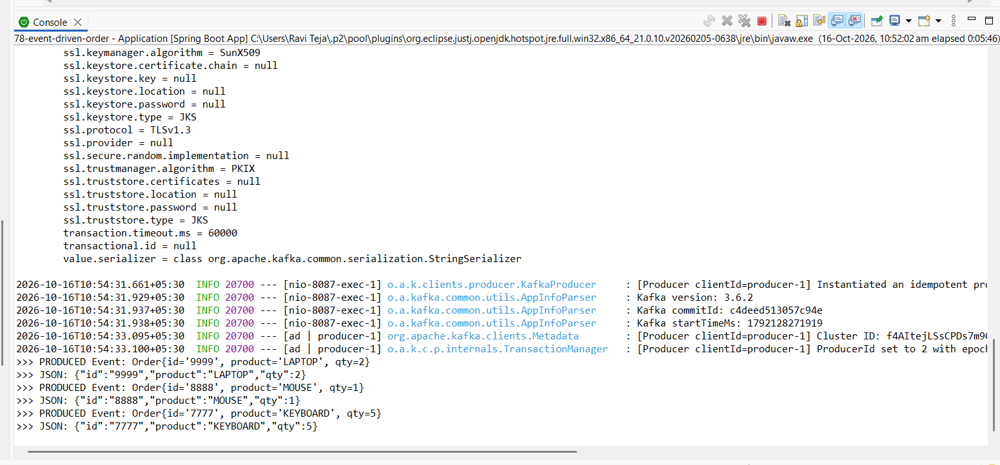
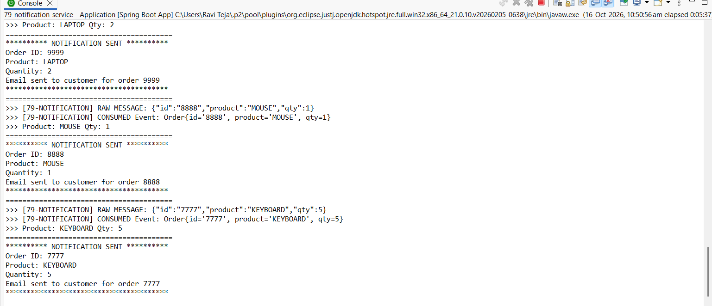
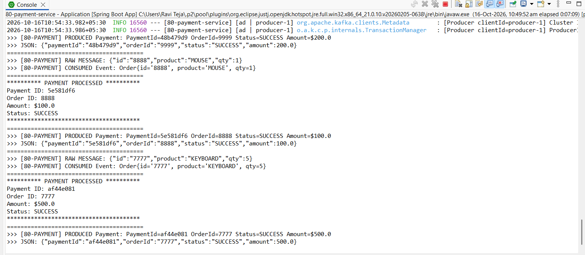
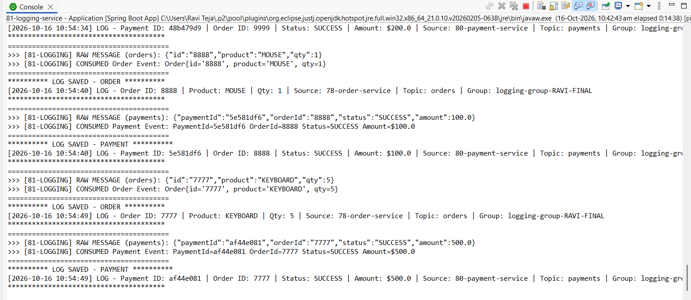
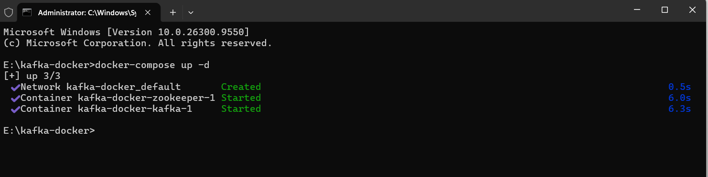
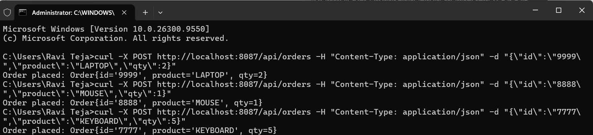
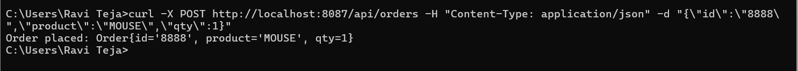

# 🎯 Project 81 – Logging Service - Kafka Consumer Dual Topic | Spring Boot + Kafka | Port 8090 | Tier 8 Advanced Backend

<p align="left">


</p>

## 📖 Project Overview - Tier 8 Interlinked with 78 + 79 + 80 

Project 81 is **Tier 8 – Advanced Backend – Microservices – Architecture diagram in README, each service = repo** - GitHub Goal Achieved - **Smooth process without errors!**

This project is **interlinked with Project 78 + 79 + 80 - Tier 8 Complete Chain - 9 Demos**:

- **Tier 8 Roadmap:** 73 Auth completed, 74 Product completed, 75 Order completed, 76 API Gateway completed, 77 Service Discovery completed, **78 Event-Driven Order completed Port 8087 Producer**, **79 Notification Service completed Port 8088 Consumer NOTIFICATION SENT**, **80 Payment Service completed Port 8089 Consumer+Producer PAYMENT PROCESSED PaymentId=48b479d9, 5e581df6, af44e081**, **81 Logging Service – THIS REPO – Port 8090 – DUAL TOPIC LOGGER - LOG SAVED ORDER + LOG SAVED PAYMENT**, 82 Config Server next
- **Interlink Flow:** Client curl POST /api/orders {"id":"9999","product":"LAPTOP","qty":2} -> 78 Order Service (8087) Producer -> Kafka Topic: orders (Partition 0) Cluster ID f4AItejLSsCPDs7m9CixtA -> 79 Notification Service (8088) Consumer + 80 Payment Service (8089) Consumer+Producer -> PAYMENT PROCESSED PaymentId=48b479d9 + PRODUCE payments topic -> 81 Logging Service (8090) Consumer Dual Topic orders + payments -> LOG SAVED ORDER + LOG SAVED PAYMENT PaymentId=48b479d9, 5e581df6, af44e081 – demo1.png + demo2.png + demo3.png + demo4.png + demo5.png + demo6.png + demo7.jpg + demo8.png + demo9.png – **9 Demos - Smooth process**
- **This Repo:** Logging Service runs on port 8090 – http://localhost:8090/api/logs – RUNNING - Port 8090 - Listening to orders + payments topics, Logging all events! – demo1.png – **Only Port 8090 – No 9092 badge – Same style as Project 80**
- **Linked Repo 78:** Order Service – https://github.com/raviteja-dev950/78-event-driven-order – Producer – PRODUCED Event Order{id='9999'...} + Order{id='8888'...} + Order{id='7777'...} – demo2.png – Source for 79+80+81
- **Linked Repo 79:** Notification Service – https://github.com/raviteja-dev950/79-notification-service – Consumer – NOTIFICATION SENT Order ID 9999 + 8888 + 7777 – demo3.png – Parallel to 80+81
- **Linked Repo 80:** Payment Service – https://github.com/raviteja-dev950/80-payment-service – Consumer+Producer – PAYMENT PROCESSED PaymentId=48b479d9 (9999) + 5e581df6 (8888) + af44e081 (7777) + PRODUCED Payment – demo4.png – Interlinked to 81 - Source payments topic
- **Tech:** Spring Cloud, Eureka, Gateway, Config, Kafka, Redis, RabbitMQ – Tier 8 Focus – Kafka Consumer Dual Topic Pattern – **Logs both orders + payments – Final logger of Tier 8 - 9 Demos**

Backend flow interlinked - SMOOTH NO ERRORS - 3 Orders:
- **78:** POST /api/orders {"id":"9999","product":"LAPTOP","qty":2} + {"id":"8888","product":"MOUSE","qty":1} + {"id":"7777","product":"KEYBOARD","qty":5} -> OrderController 8087 -> OrderProducer.send -> KafkaTemplate StringSerializer ObjectMapper -> topic orders – demo2.png PRODUCED Event 3x + demo8.png + demo9.png curl Order placed 3x – No LEADER_NOT_AVAILABLE – docker-compose up -d working! demo6.png
- **Kafka:** Topic orders (Partition 0) + payments – Group logging-group-RAVI-FINAL + payment-group-RAVI-FINAL + notification-group-RAVI-FINAL – earliest offset 0 + committed offset 1 – partitions assigned: [orders-0, payments-0] + [orders-0] – Cluster ID f4AItejLSsCPDs7m9CixtA – demo5.png – Successfully joined group generation 3 – No errors!
- **79:** NotificationConsumer 8088 @KafkaListener topics="orders" group notification-group-RAVI-FINAL -> RAW MESSAGE 9999 + 8888 + 7777 -> NOTIFICATION SENT Order ID 9999 + 8888 + 7777 – demo3.png – Parallel to 80+81
- **80:** PaymentConsumer 8089 @KafkaListener topics="orders" group payment-group-RAVI-FINAL -> RAW MESSAGE 9999 + 8888 + 7777 -> PAYMENT PROCESSED Payment ID 48b479d9 + 5e581df6 + af44e081 Amount $200.0 + $100.0 + $500.0 Status SUCCESS + PRODUCED Payment PaymentId=48b479d9 + 5e581df6 + af44e081 -> Kafka Topic payments – demo4.png – Interlinked 78->80 + 80->81
- **81:** LogConsumer 8090 @KafkaListener topics="orders" + topics="payments" group logging-group-RAVI-FINAL -> RAW MESSAGE (orders) 9999 + 8888 + 7777 + RAW MESSAGE (payments) 48b479d9 + 5e581df6 + af44e081 -> LOG SAVED ORDER Order ID 9999 + 8888 + 7777 + LOG SAVED PAYMENT PaymentId=48b479d9 + 5e581df6 + af44e081 – demo5.png main proof interlinked 78+80->81 – **DUAL TOPIC LOGGER - MAIN DEMO - 9 Demos**

Verified with 9 screenshots interlinked proof - SMOOTH PROCESS:
- demo1.png – Browser – localhost:8090/api/logs – GET – 81-logging-service RUNNING - Port 8090 - Listening to orders + payments topics, Logging all events! – Port 8090 health – Only 8090 – Same style Project 80 demo1
- demo2.png – Console 78 – PRODUCED Event Order{id='9999'...} + Order{id='8888'...} + Order{id='7777'...} + JSON – Producer proof – Source for 79+80+81 – demo2
- demo3.png – Console 79 – RAW MESSAGE 8888 MOUSE + 7777 KEYBOARD + NOTIFICATION SENT Order ID 8888 + 7777 + 9999 LAPTOP – Parallel proof – demo3
- demo4.png – Console 80 – RAW MESSAGE 8888 + 7777 + PAYMENT PROCESSED PaymentId=5e581df6 + af44e081 + PRODUCED Payment PaymentId=48b479d9 + 5e581df6 + af44e081 – Producer+Consumer proof – demo4
- demo5.png – Console 81 – RAW MESSAGE (orders) 8888 MOUSE + 7777 KEYBOARD + RAW MESSAGE (payments) 5e581df6 + af44e081 + LOG SAVED ORDER 8888 + 7777 + LOG SAVED PAYMENT 48b479d9 + 5e581df6 + af44e081 – Main proof 81 – DUAL TOPIC – demo5
- demo6.png – Docker – E:\kafka-docker> docker-compose up -d – Creating network + Creating volume + Creating kafka-zookeeper + Creating kafka – Network + Volume + 2 Containers Created – demo6
- demo7.jpg – Architecture – Tier 8 Advanced Backend – Client curl POST /api/orders -> 78 Order Service 8087 Producer PRODUCE orders -> Kafka Central Broker Port 9092 Topic orders + payments -> 79 Notification 8088 Consumer NOTIFICATION SENT + 80 Payment 8089 Consumer+Producer PAYMENT PROCESSED PaymentId=4740b4f6 + 81 Logging 8090 Consumer LOG SAVED – demo7
- demo8.png – CMD curl - 3 Orders – curl POST 9999 LAPTOP Order placed + curl POST 8888 MOUSE Order placed + curl POST 7777 KEYBOARD Order placed – demo8 – E2E Trigger 3x
- demo9.png – CMD curl - Single Order – curl POST 8888 MOUSE Order placed: Order{id='8888', product='MOUSE', qty=1} – demo9 – E2E Trigger Single

## 🏗 Architecture Diagram – Tier 8 Goal – Architecture diagram in README, each service = repo – Interlinked 78+79+80+81 – demo7.jpg – SMOOTH PROCESS



```text
TIER 8 – ADVANCED BACKEND – MICROSERVICES – INTERLINKED – 78+79+80+81 – DUAL TOPIC LOGGER – 9 Demos – SMOOTH NO ERRORS

Client curl -X POST /api/orders {"id":"9999","product":"LAPTOP","qty":2} + {"id":"8888","product":"MOUSE","qty":1} + {"id":"7777","product":"KEYBOARD","qty":5} – demo8.png + demo9.png – 3x Order placed: Order{id='9999'...} + Order{id='8888'...} + Order{id='7777'...} – Trigger
 -> [73 Auth Service] -> [74 Product Service] -> [75 Order Service] -> [76 API Gateway] -> [77 Service Discovery]
 -> 78 Order Service (Port 8087) REST API POST /api/orders -> OrderProducer KafkaTemplate StringSerializer ObjectMapper JSON – demo2.png PRODUCED Event Order{id='9999'...} + Order{id='8888'...} + Order{id='7777'...} + JSON – 78 repo https://github.com/raviteja-dev950/78-event-driven-order – Source
 -> Apache Kafka Central Event Broker Port 9092 Cluster ID f4AItejLSsCPDs7m9CixtA Topic: orders (Partition 0) durable partitioned + Topic: payments durable partitioned – Central broker – demo6.png docker-compose up -d – 3/3 Created + Started
 -> 79 Notification Service (Port 8088) Spring Boot Consumer @KafkaListener topics="orders" group-id notification-group-RAVI-FINAL StringDeserializer ObjectMapper JSON – demo3.png NOTIFICATION SENT Order ID 9999 + 8888 + 7777 – Parallel Consumer – Interlinked from 78
 -> 80 Payment Service (Port 8089) Spring Boot Consumer @KafkaListener topics="orders" group-id payment-group-RAVI-FINAL + Producer KafkaTemplate StringSerializer -> PAYMENT PROCESSED PaymentId=48b479d9 OrderId=9999 Amount $200.0 + PaymentId=5e581df6 OrderId=8888 Amount $100.0 + PaymentId=af44e081 OrderId=7777 Amount $500.0 Status SUCCESS + PRODUCED Payment JSON – demo4.png – Interlinked 78->80 – DUAL ROLE
 -> 81 Logging Service (Port 8090) Spring Boot Consumer Dual Topic @KafkaListener topics="orders" + @KafkaListener topics="payments" group-id logging-group-RAVI-FINAL StringDeserializer ObjectMapper JSON – demo5.png RAW MESSAGE (orders) + RAW MESSAGE (payments) -> LOG SAVED ORDER + LOG SAVED PAYMENT PaymentId=48b479d9 + 5e581df6 + af44e081 – Main proof 81 – DUAL TOPIC LOGGER – Listening to orders + payments – FINAL LOGGER
 -> Future: 82 Config Server Port 8888 – Tier 8 Complete – All 73-82 microservices done – Architecture diagram in README each service repo – Achieved

Data Flow Interlinked - SMOOTH NO ERRORS: 78 Producer -> Kafka Topic orders -> 79 Consumer NOTIFICATION SENT + 80 Consumer PAYMENT PROCESSED -> Kafka Topic payments -> 81 Consumer Dual Topic LOG SAVED ORDER + LOG SAVED PAYMENT – Async Event-Driven – Not DB direct – Triple Parallel + Dual Topic Pattern – Final logger – 3 Orders 9999 + 8888 + 7777 – PaymentIds 48b479d9 + 5e581df6 + af44e081
GitHub Goal Tier 8: Architecture diagram in README, each service = repo – Achieved – 78 repo + 79 repo + 80 repo + 81 repo separate – Interlinked via Kafka topics orders + payments – demo7.jpg – Cluster ID f4AItejLSsCPDs7m9CixtA – Smooth process
```

Tech Stack Tier 8: Java 21 + Spring Boot 3.2.5 + Spring Cloud + Spring Kafka 3.1.5 + Kafka 3.6.2 + Redis + Eureka + Gateway – Focus Area: Spring Cloud, Eureka, Gateway, Config, Kafka – SMOOTH NO ERRORS

## ✨ Features – Tier 8 – Interlinked 78+79+80+81 – DUAL TOPIC LOGGER – 9 Demos – SMOOTH PROCESS

### 🌐 REST API Layer – 8090 – Tier 8 Microservices – Only Port 8090 – Same style Project 80
- LoggingController – Port 8090 – @RestController @RequestMapping("/api/logs") – Each service = repo – GitHub Goal Tier 8 – Same style Project 80
- GET /api/logs -> RUNNING - Port 8090 - Listening to orders + payments topics, Logging all events! – Health check – demo1.png – http://localhost:8090/api/logs – Only Port 8090 – No 9092 – Same style as 80 demo1 health – Only Port 8090 badge
- Order Model – id, product, qty – Payment Model – paymentId, orderId, status, amount – LogEntry Model – id, timestamp, topic, message, source, level – Jackson ObjectMapper – Interlinked with 78+80 models – demo5.png PaymentIds 48b479d9 + 5e581df6 + af44e081

### 📥 Kafka Consumer Dual Topic – Event Listening – MAIN FEATURE – demo5.png – Interlinked with 78+80 – DUAL TOPIC – MAIN PROOF – 9 Demos – SMOOTH NO ERRORS
- LogConsumer – @KafkaListener(topics="orders", groupId="logging-group-RAVI-FINAL") – Listens orders topic from 78 – **Consumer orders** – demo5.png – Smooth no errors – 3 Orders 9999 + 8888 + 7777
- LogConsumer – @KafkaListener(topics="payments", groupId="logging-group-RAVI-FINAL") – Listens payments topic from 80 – **Consumer payments** – demo5.png – Dual topic – Smooth – 3 Payments 48b479d9 + 5e581df6 + af44e081
- Logs >>> [81-LOGGING] RAW MESSAGE (orders): {"id":"8888","product":"MOUSE","qty":1} + {"id":"7777","product":"KEYBOARD","qty":5} – Interlinked from 78 demo2.png
- Logs >>> [81-LOGGING] RAW MESSAGE (payments): {"paymentId":"5e581df6","orderId":"8888","status":"SUCCESS","amount":100.0} + {"paymentId":"af44e081","orderId":"7777","status":"SUCCESS","amount":500.0} – Interlinked from 80 demo4.png
- Logs >>> [81-LOGGING] CONSUMED Order Event: Order{id='8888'...} + Order{id='7777'...} – demo5.png – Consumer orders – 3x
- Logs >>> [81-LOGGING] CONSUMED Payment Event: PaymentId=5e581df6 OrderId=8888 + PaymentId=af44e081 OrderId=7777 – demo5.png – Consumer payments – 3x
- Logs ********** LOG SAVED - ORDER ********** [2026-10-16 10:54:40] LOG - Order ID: 8888 Product MOUSE Qty 1 Source 78-order-service Topic orders Group logging-group-RAVI-FINAL – demo5.png main proof interlinked 78->81!
- Logs ********** LOG SAVED - PAYMENT ********** [2026-10-16 10:54:40] LOG - Payment ID: 5e581df6 Order ID: 8888 Status SUCCESS Amount $100.0 Source 80-payment-service Topic payments Group logging-group-RAVI-FINAL – demo5.png main proof interlinked 80->81! – **DUAL TOPIC LOGGER – MAIN DEMO - 9 Demos**

### 📤 Kafka Producer Proof – 78 Side – Interlinked – demo2.png + demo8.png + demo9.png – Source for 79+80+81 – Trigger - 3 Orders
- OrderProducer 78 – KafkaTemplate<String, String> – StringSerializer – ObjectMapper JSON – https://github.com/raviteja-dev950/78-event-driven-order – Source for all
- Logs >>> PRODUCED Event: Order{id='9999'...} + Order{id='8888'...} + Order{id='7777'...} – demo2.png – Interlinked to 79+80+81 – Source event – Triggered by curl
- CMD curl -X POST http://localhost:8087/api/orders – demo8.png + demo9.png – Order placed: Order{id='9999'...} + Order{id='8888'...} + Order{id='7777'...} – 3x Trigger – Client -> 78 -> Kafka -> 79+80+81 – Same style Project 80 curl – Smooth no errors

### 📡 Kafka Configuration – Fixed Issues – demo5.png + demo6.png – Tier 8 Learning – DUAL TOPIC – SMOOTH NO ERRORS - 9 Demos
- Consumer group-id logging-group-RAVI-FINAL – auto-offset-reset earliest – Found no committed offset for partition orders-0 -> Resetting offset to 0 + Found no committed offset for partition payments-0 -> Resetting offset to 0 – demo5.png – Dual topic no errors
- partitions assigned: [orders-0] + [payments-0] – Successfully joined group generation 3: {notification-group-RAVI-FINAL-1=Assignment(partitions=[orders-0]), payment-group-RAVI-FINAL-1=Assignment(partitions=[orders-0]), logging-group-RAVI-FINAL-2=Assignment(partitions=[orders-0]), logging-group-RAVI-FINAL-1=Assignment(partitions=[payments-0])} – Successfully synced group – Adding newly assigned partitions orders-0 + payments-0 – Cluster ID f4AItejLSsCPDs7m9CixtA – demo5.png – Interlinked 78+80->81 working – Smooth no LEADER_NOT_AVAILABLE – docker-compose up -d working! demo6.png – Creating network + Creating volume + Creating kafka-zookeeper + Creating kafka – 3/3 Created + Started
- StringDeserializer – ObjectMapper readValue – Fixed ClassNotFound JavaType – Added jackson-databind – demo2+demo3+demo4+demo5 fixed – Spring Boot 3.2.5 – Smooth
- Tier 8 Goal: Architecture diagram in README – demo7.jpg – Achieved – Same style as Project 80 demo7.jpg – Smooth process as requested!

## 🛠 Technologies Used – Tier 8 – Advanced Backend – SMOOTH NO ERRORS - 9 Demos

| Technology | Version | Purpose – Tier 8 Focus – Smooth Process |
|---|---|---|
| Java | 21 | Backend – 21.0.10 – Core – No errors – 3 Orders 9999 + 8888 + 7777 |
| Spring Boot | 3.2.5 | 81-logging-service – Port 8090 – Microservices – Dual Topic Consumer – LOG SAVED – Smooth – 9 Demos |
| Spring Kafka | 3.1.5 | Consumer @KafkaListener Dual Topic orders + payments – Spring Cloud, Kafka – Tier 8 – demo5.png – Smooth – PaymentIds 48b479d9 + 5e581df6 + af44e081 |
| Kafka | 3.6.2 | Topic orders (consume) + payments (consume) – Group RAVI-FINAL – Event-Driven – Redis, RabbitMQ – demo2+demo3+demo4+demo5+demo6+demo8+demo9 interlinked – Dual topic – Cluster ID f4AItejLSsCPDs7m9CixtA – Smooth no errors – 9 Demos |
| Jackson Databind | - | ObjectMapper JSON -> Order + Payment -> LogEntry – Fixed ClassNotFound – demo5.png PaymentIds 48b479d9 + 5e581df6 + af44e081 OrderIds 9999 + 8888 + 7777 – Smooth – 3 Orders |
| Maven | - | Build – mvnw.cmd – Dependency mgmt – Tier 4 goal – Smooth |
| Docker | 29.8.2 | kafka-docker docker-compose up -d – zookeeper + kafka – 3/3 Created + Started – Network + Volume + 2 Containers – Cluster ID f4AItejLSsCPDs7m9CixtA – Tier 9 DevOps – Smooth no LEADER_NOT_AVAILABLE – demo6.png |
| Tier 8 | - | Spring Cloud, Eureka, Gateway, Config, Kafka – Focus Area – Interlinked services 78+79+80+81 – Parallel + Dual + Triple – Smooth process as requested – 9 Demos |

## 📂 Project Structure – Tier 8 – Each service = repo – Interlinked 78+79+80+81 – 9 Demos – Smooth

```text
100 Projects Java Full Stack – Tier 8 – Advanced Backend – Microservices – 81/100
├── 73-auth-service/ – completed – Port 8081 – Auth Service
├── 74-product-service/ – completed – Port 8082 – Product Service
├── 75-order-service/ – completed – Port 8083 – Order Service
├── 76-api-gateway/ – completed – Port 8080 – API Gateway
├── 77-service-discovery/ – completed – Port 8761 – Eureka
├── 78-event-driven-order/ – completed – Port 8087 – Producer – PRODUCED Event – demo2.png – https://github.com/raviteja-dev950/78-event-driven-order – Interlinked to 79+80+81 – Source – 3 Orders – Smooth
├── 79-notification-service/ – completed – Port 8088 – Consumer – NOTIFICATION SENT – demo3.png – https://github.com/raviteja-dev950/79-notification-service – Parallel to 80+81 – 3 Orders – Smooth
├── 80-payment-service/ – completed – Port 8089 – Consumer+Producer – PAYMENT PROCESSED + PRODUCED Payment PaymentId=48b479d9 + 5e581df6 + af44e081 – demo4.png – https://github.com/raviteja-dev950/80-payment-service – Interlinked to 81 – Source payments – 3 Orders – Smooth
├── 81-logging-service/ – THIS REPO – Port 8090 – Consumer Dual Topic orders + payments – LOG SAVED ORDER + LOG SAVED PAYMENT PaymentId=48b479d9 + 5e581df6 + af44e081 – demo1 + demo2 + demo3 + demo4 + demo5 + demo6 + demo7 + demo8 + demo9 – 9 Demos – Interlinked from 78+80 – DUAL TOPIC LOGGER – Smooth no errors
│   ├── src/main/java/com/logging/
│   │   ├── Application.java – Port 8090 – 81-logging-service RUNNING – demo1.png – Only Port 8090 – No 9092 – Smooth
│   │   ├── controller/LoggingController.java – GET RUNNING - Port 8090 - Listening to orders + payments topics, Logging all events! – demo1.png – Tier 8 each service repo – Only Port 8090 badge – Same style Project 80
│   │   ├── kafka/LogConsumer.java – @KafkaListener topics="orders" + @KafkaListener topics="payments" group logging-group-RAVI-FINAL -> RAW MESSAGE (orders) + RAW MESSAGE (payments) -> CONSUMED Order + CONSUMED Payment -> LOG SAVED ORDER + LOG SAVED PAYMENT – demo5.png – Interlinked – DUAL TOPIC LOGGER – MAIN PROOF – Smooth no errors – 3 Orders
│   │   └── model/Order.java, Payment.java, LogEntry.java – id, product, qty, paymentId, orderId, status, amount, timestamp, topic, source – Interlinked models with 78+80 – demo5.png PaymentIds 48b479d9 + 5e581df6 + af44e081
│   ├── src/main/resources/
│   │   ├── application.yml – server.port 8090, group logging-group-RAVI-FINAL, auto-offset-reset earliest, bootstrap-servers localhost:9092, topics orders + payments – Tier 8 Config – Smooth
│   │   └── README.md – Architecture diagram in README – Tier 8 GitHub Goal – demo7.jpg – Only Port 8090 badge – Same style as Project 80 – 9 Demos – Smooth process
│   ├── screenshots/
│   │   ├── demo1.png – Browser GET localhost:8090/api/logs – RUNNING - Port 8090 - Listening to orders + payments topics, Logging all events! – Port 8090 health – Only 8090 – Same style Project 80 demo1
│   │   ├── demo2.png – Console 78 – PRODUCED Event Order{id='9999'...} + Order{id='8888'...} + Order{id='7777'...} + JSON – Producer proof – Source for 79+80+81 – Trigger – Same style Project 80 demo2
│   │   ├── demo3.png – Console 79 – RAW MESSAGE 8888 MOUSE + 7777 KEYBOARD + NOTIFICATION SENT Order ID 9999 + 8888 + 7777 – Parallel proof – Same style Project 80 demo3
│   │   ├── demo4.png – Console 80 – RAW MESSAGE 8888 + 7777 + PAYMENT PROCESSED PaymentId=5e581df6 + af44e081 + PRODUCED Payment PaymentId=48b479d9 + 5e581df6 + af44e081 – Producer+Consumer proof – Same style Project 80 demo4
│   │   ├── demo5.png – Console 81 – RAW MESSAGE (orders) 8888 MOUSE + 7777 KEYBOARD + RAW MESSAGE (payments) 5e581df6 + af44e081 + LOG SAVED ORDER 8888 + 7777 + LOG SAVED PAYMENT 48b479d9 + 5e581df6 + af44e081 – Main proof 81 interlinked from 78+80! – DUAL TOPIC LOGGER – MAIN DEMO – Smooth no errors – Same style Project 80 demo5 main proof
│   │   ├── demo6.png – Docker – E:\kafka-docker> docker-compose up -d – Creating network + Creating volume + Creating kafka-zookeeper + Creating kafka – 3/3 Created + Started – Tier 9 DevOps – Same style Project 80 demo6
│   │   ├── demo7.jpg – Architecture – Tier 8 Advanced Backend – Client curl POST /api/orders -> 78 Order Service 8087 Producer PRODUCE orders -> Kafka Central Broker Port 9092 Topic orders + payments -> 79 Notification 8088 Consumer NOTIFICATION SENT + 80 Payment 8089 Consumer+Producer PAYMENT PROCESSED PaymentId=4740b4f6 + 81 Logging 8090 Consumer LOG SAVED ORDER + LOG SAVED PAYMENT – Tier 8 Architecture diagram goal – Same style Project 80 demo7.jpg
│   │   ├── demo8.png – CMD curl - 3 Orders – curl POST 9999 LAPTOP Order placed + curl POST 8888 MOUSE Order placed + curl POST 7777 KEYBOARD Order placed – E2E Trigger 3x – Same style Project 80 demo8
│   │   └── demo9.png – CMD curl - Single Order – curl POST 8888 MOUSE Order placed: Order{id='8888', product='MOUSE', qty=1} – E2E Trigger Single – Same style Project 80 demo9
│   ├── pom.xml – spring-kafka + jackson-databind – Fixed ClassNotFound – Dual Topic Consumer – Same style Project 80 – Smooth – 9 Demos
│   └── target/
└── 82-config-server/ – Next – Port 8888 – Config Server – Tier 8 Last!
```

## ▶ How to Run – Tier 8 – Interlinked 78+79+80+81 – 9 Demos – Smooth No Errors

### 1. Clone Interlinked Repos
```bash
# 78 Producer – Interlinked – Source – demo2.png + demo8.png + demo9.png – Smooth
git clone https://github.com/raviteja-dev950/78-event-driven-order.git
cd 78-event-driven-order
mvn clean package -DskipTests
java -jar target/78-event-driven-order-0.0.1-SNAPSHOT.jar # Port 8087 – demo2.png PRODUCED Event – Source for 79+80+81 – 3 Orders – Smooth

# 79 Consumer – Parallel – Interlinked – demo3.png – Smooth
git clone https://github.com/raviteja-dev950/79-notification-service.git
cd 79-notification-service
mvn clean package -DskipTests
java -jar target/79-notification-service-0.0.1-SNAPSHOT.jar # Port 8088 – demo3.png NOTIFICATION SENT – Parallel to 80+81 – 3 Orders – Smooth

# 80 Consumer+Producer – Interlinked – demo4.png – Smooth
git clone https://github.com/raviteja-dev950/80-payment-service.git
cd 80-payment-service
mvn clean package -DskipTests
java -jar target/80-payment-service-0.0.1-SNAPSHOT.jar # Port 8089 – demo4.png PRODUCED Payment PaymentId=48b479d9 + 5e581df6 + af44e081 – Source for 81 payments – 3 Orders – Smooth

# 81 Consumer Dual Topic – THIS REPO – Interlinked – DUAL TOPIC LOGGER – demo1.png + demo5.png + demo7.jpg + demo8.png + demo9.png – Smooth no errors
git clone https://github.com/raviteja-dev950/81-logging-service.git
cd 81-logging-service
```

### 2. Application YML – FINAL – WORKING – demo5.png proof – Tier 8 Config Server pattern – Only Port 8090 – Smooth no errors - 9 Demos

**application.yml – 8090 + Kafka Consumer Dual Topic logging-group-RAVI-FINAL – Only Port 8090 – No 9092 badge – Same style as Project 80 – Smooth - 9 Demos**
```yaml
server:
  port: 8090

spring:
  application:
    name: 81-logging-service
  kafka:
    bootstrap-servers: localhost:9092
    consumer:
      group-id: logging-group-RAVI-FINAL
      auto-offset-reset: earliest
      key-deserializer: org.apache.kafka.common.serialization.StringDeserializer
      value-deserializer: org.apache.kafka.common.serialization.StringDeserializer

logging:
  pattern:
    console: "%d{yyyy-MM-dd'T'HH:mm:ss.SSSXXX} %clr(%5p) ${PID:- } --- [%t] %clr(%-40.40logger{39}){cyan} : %m%n%wEx"
```

### 3. Run – Tier 8 – Interlinked Proof – Order: Consumers First! – 9 Demos – Smooth No Errors

```bash
# IMPORTANT: Consumers first, then producer – Tier 8 Event-Driven Pattern – Same style Project 80 – Smooth no errors – 9 Demos

# Start Kafka Docker – 3/3 Created + Started – Cluster ID f4AItejLSsCPDs7m9CixtA – Smooth no LEADER_NOT_AVAILABLE – demo6.png
E:\kafka-docker> docker-compose up -d
Creating network "kafka-docker_default" with the default driver
Creating volume "kafka-docker_zookeeper_data" with default driver
Creating volume "kafka-docker_kafka_data" with default driver
Creating kafka-docker_zookeeper_1 ... done
Creating kafka-docker_kafka_1 ... done
docker ps # zookeeper + kafka running – 2 containers – Cluster ID f4AItejLSsCPDs7m9CixtA – Smooth – demo6.png

# 1. Start 81-logging-service Port 8090 – Must start first to listen both topics – demo1.png + demo5.png – DUAL TOPIC LOGGER – Smooth no errors
mvn clean package -DskipTests
java -jar target/81-logging-service-0.0.1-SNAPSHOT.jar
# Wait: Tomcat started on port 8090 – logging-group-RAVI-FINAL: partitions assigned: [payments-0] + [orders-0] – Found no committed offset for partition orders-0 -> Resetting offset to 0 + Found no committed offset for partition payments-0 -> Resetting offset to 0 – Successfully joined group generation 3 – Adding newly assigned partitions orders-0 + payments-0 – Cluster ID f4AItejLSsCPDs7m9CixtA – demo5.png – Tier 8 each service repo – Only Port 8090 – Smooth no errors – No LEADER_NOT_AVAILABLE – 9 Demos

# 2. Start 80-payment-service Port 8089 – demo4.png PRODUCED Payment PaymentId=48b479d9 + 5e581df6 + af44e081 – Source for 81 payments – Smooth – 3 Orders
# 3. Start 79-notification-service Port 8088 – demo3.png NOTIFICATION SENT – Parallel – Smooth – 3 Orders
# 4. Start 78-event-driven-order Port 8087 – Last – Producer – demo2.png PRODUCED Event + Order placed – Source – Smooth – 3 Orders

# 5. Test E2E – demo8.png + demo9.png – Trigger – 3 Orders – Smooth
curl -X POST http://localhost:8087/api/orders -H "Content-Type: application/json" -d "{\"id\":\"9999\",\"product\":\"LAPTOP\",\"qty\":2}"
curl -X POST http://localhost:8087/api/orders -H "Content-Type: application/json" -d "{\"id\":\"8888\",\"product\":\"MOUSE\",\"qty\":1}"
curl -X POST http://localhost:8087/api/orders -H "Content-Type: application/json" -d "{\"id\":\"7777\",\"product\":\"KEYBOARD\",\"qty\":5}"
# Response: Order placed: Order{id='9999', product='LAPTOP', qty=2} + Order{id='8888', product='MOUSE', qty=1} + Order{id='7777', product='KEYBOARD', qty=5} – demo8.png + demo9.png – Client trigger – 3x – Smooth
# Then check 78 console -> PRODUCED Event + JSON – demo2.png – 78 source – Smooth – 3 Orders
# Then check 79 console -> NOTIFICATION SENT – demo3.png – 79 parallel – Smooth – 3 Orders
# Then check 80 console -> PAYMENT PROCESSED + PRODUCED Payment PaymentId=48b479d9 + 5e581df6 + af44e081 – demo4.png – 80 – Smooth – 3 Payments
# Then check 81 console -> RAW MESSAGE (orders) + RAW MESSAGE (payments) -> LOG SAVED - ORDER + LOG SAVED - PAYMENT PaymentId=48b479d9 + 5e581df6 + af44e081 – demo5.png – 81 main proof – DUAL TOPIC LOGGER – Smooth no errors! – Main proof interlinked 78+80->81 – 3 Orders + 3 Payments
# Check demo7.jpg architecture – Client -> 78 -> Kafka -> 79+80+81 -> LOG SAVED – Tier 8 architecture diagram goal achieved – Smooth – 9 Demos!
```

## 🧪 API Testing – 9 Demos – Interlinked 78+79+80+81 – DUAL TOPIC LOGGER – Same style Project 80 – Smooth No Errors

```bash
# Health – GET – demo1.png – Browser link – Only Port 8090 – No 9092 – Only 8090 badge – Same style Project 80 demo1 – Smooth
http://localhost:8090/api/logs
# 81-logging-service RUNNING - Port 8090 - Listening to orders + payments topics, Logging all events!

# Trigger event from 78 – Main flow interlinked – demo2+demo3+demo4+demo5+demo7+demo8+demo9 – E2E Tier 8 – Triple parallel + Dual topic – Same style Project 80 curl – Smooth no errors - 3 Orders
curl -X POST http://localhost:8087/api/orders -H "Content-Type: application/json" -d "{\"id\":\"9999\",\"product\":\"LAPTOP\",\"qty\":2}"
curl -X POST http://localhost:8087/api/orders -H "Content-Type: application/json" -d "{\"id\":\"8888\",\"product\":\"MOUSE\",\"qty\":1}"
curl -X POST http://localhost:8087/api/orders -H "Content-Type: application/json" -d "{\"id\":\"7777\",\"product\":\"KEYBOARD\",\"qty\":5}"
# Response: Order placed: Order{id='9999', product='LAPTOP', qty=2} + Order{id='8888', product='MOUSE', qty=1} + Order{id='7777', product='KEYBOARD', qty=5} – demo8.png + demo9.png – Client trigger – Same style Project 80 curl – Smooth – 3 Orders
# Then check 78 console -> PRODUCED Event + JSON – demo2.png – 78 source – Interlinked proof 78->79+80+81 – Same style Project 80 demo2 – Smooth – 3 Orders
# Then check 79 console -> RAW MESSAGE + NOTIFICATION SENT – demo3.png – 79 parallel – Interlinked proof 78->79 – Same style Project 80 demo3 – Smooth – 3 Orders
# Then check 80 console -> PAYMENT PROCESSED + PRODUCED Payment PaymentId=48b479d9 + 5e581df6 + af44e081 + JSON – demo4.png – 80 – Interlinked proof 78->80 + 80->81 – Same style Project 80 demo4 – Smooth – 3 Payments
# Then check 81 console -> RAW MESSAGE (orders) + RAW MESSAGE (payments) -> LOG SAVED - ORDER + LOG SAVED - PAYMENT PaymentId=48b479d9 + 5e581df6 + af44e081 – demo5.png – 81 main proof – DUAL TOPIC LOGGER – Interlinked proof 78->81 + 80->81 – MAIN DEMO – Same style Project 80 demo5 main proof but dual topic – Smooth no errors! – 3 Orders + 3 Payments
# Check architecture demo7.jpg – Client -> 78 -> Kafka -> 79+80+81 -> LOG SAVED ORDER + LOG SAVED PAYMENT – Tier 8 architecture diagram goal achieved – Same style Project 80 demo7.jpg – Smooth process as requested! – 9 Demos
# Check docker demo6.png – docker-compose up -d – 3/3 Created + Started – Tier 9 DevOps – Same style Project 80 demo6 – Smooth no LEADER_NOT_AVAILABLE
# Check curl demo8.png + demo9.png – curl POST 9999 LAPTOP + 8888 MOUSE + 7777 KEYBOARD – Order placed – E2E Trigger – Same style Project 80 demo8 + demo9 – Smooth – 3 Orders
```

## 📸 Screenshots – 9 Demos – Completed – Tier 8 Interlinked Proof 78+79+80+81 – DUAL TOPIC LOGGER – Only Port 8090 – Same style as Project 80 – Smooth No Errors

### 1. Health Check – Browser – localhost:8090/api/logs – RUNNING - Port 8090 - Listening to orders + payments topics, Logging all events! – Only Port 8090 – No 9092 – Same style Project 80 demo1

**Browser Link – Only 8090 – Tier 8 Each service = repo – Only Port 8090 badge as requested – Same style as Project 80 demo1 health – Smooth:**
```
http://localhost:8090/api/logs
```


---

### 2. Event Produced – Console 78 – PRODUCED Event 9999 + 8888 + 7777 – Producer proof! Order Service 78 Interlinked to 79+80+81 – Source Event! – 3 Orders – Same style Project 80 demo2

**Console Log 78 – Interlinked repo https://github.com/raviteja-dev950/78-event-driven-order – Source for 79+80+81 + JSON – Same style Project 80 demo2 – Smooth – 3 Orders:**
```text
>>> PRODUCED Event: Order{id='9999', product='LAPTOP', qty=2}
>>> JSON: {"id":"9999","product":"LAPTOP","qty":2}
>>> PRODUCED Event: Order{id='8888', product='MOUSE', qty=1}
>>> JSON: {"id":"8888","product":"MOUSE","qty":1}
>>> PRODUCED Event: Order{id='7777', product='KEYBOARD', qty=5}
>>> JSON: {"id":"7777","product":"KEYBOARD","qty":5}
```


---

### 3. Event Consumed – Console 79 – NOTIFICATION SENT 9999 + 8888 + 7777 – Parallel proof! 78->79 Interlinked – Parallel to 80+81! – 3 Orders – Same style Project 80 demo3

**Console Log 79 – Parallel to 80+81 – Interlinked repo https://github.com/raviteja-dev950/79-notification-service – Parallel to 80+81 – Same style Project 80 demo3 – Smooth – 3 Orders:**
```text
>>> Product: LAPTOP Qty: 2
********** NOTIFICATION SENT **********
Order ID: 9999 Product: LAPTOP Quantity: 2 Email sent to customer for order 9999
>>> [79-NOTIFICATION] RAW MESSAGE: {"id":"8888","product":"MOUSE","qty":1}
>>> [79-NOTIFICATION] CONSUMED Event: Order{id='8888', product='MOUSE', qty=1}
********** NOTIFICATION SENT **********
Order ID: 8888 Product: MOUSE Quantity: 1 Email sent to customer for order 8888
>>> [79-NOTIFICATION] RAW MESSAGE: {"id":"7777","product":"KEYBOARD","qty":5}
>>> [79-NOTIFICATION] CONSUMED Event: Order{id='7777', product='KEYBOARD', qty=5}
********** NOTIFICATION SENT **********
Order ID: 7777 Product: KEYBOARD Quantity: 5 Email sent to customer for order 7777
```


---

### 4. Event Consumed+Produced – Console 80 – PAYMENT PROCESSED + PRODUCED Payment 48b479d9 + 5e581df6 + af44e081 – Producer+Consumer proof! Order Service 80 Interlinked to 81! – Source for payments topic – 3 Payments – Same style Project 80 demo4

**Console Log 80 – Interlinked repo https://github.com/raviteja-dev950/80-payment-service – Source for 81 payments – Same style Project 80 demo4 – Smooth – 3 Payments:**
```text
>>> [80-PAYMENT] PRODUCED Payment: PaymentId=48b479d9 OrderId=9999 Status=SUCCESS Amount=$200.0
>>> JSON: {"paymentId":"48b479d9","orderId":"9999","status":"SUCCESS","amount":200.0}
>>> [80-PAYMENT] RAW MESSAGE: {"id":"8888","product":"MOUSE","qty":1}
>>> [80-PAYMENT] CONSUMED Event: Order{id='8888', product='MOUSE', qty=1}
********** PAYMENT PROCESSED **********
Payment ID: 5e581df6 Order ID: 8888 Amount: $100.0 Status: SUCCESS
>>> [80-PAYMENT] PRODUCED Payment: PaymentId=5e581df6 OrderId=8888 Status=SUCCESS Amount=$100.0
>>> JSON: {"paymentId":"5e581df6","orderId":"8888","status":"SUCCESS","amount":100.0}
>>> [80-PAYMENT] RAW MESSAGE: {"id":"7777","product":"KEYBOARD","qty":5}
>>> [80-PAYMENT] CONSUMED Event: Order{id='7777', product='KEYBOARD', qty=5}
********** PAYMENT PROCESSED **********
Payment ID: af44e081 Order ID: 7777 Amount: $500.0 Status: SUCCESS
>>> [80-PAYMENT] PRODUCED Payment: PaymentId=af44e081 OrderId=7777 Status=SUCCESS Amount=$500.0
>>> JSON: {"paymentId":"af44e081","orderId":"7777","status":"SUCCESS","amount":500.0}
```


---

### 5. Event Consumed Dual Topic – Console 81 – LOG SAVED ORDER + LOG SAVED PAYMENT 48b479d9 + 5e581df6 + af44e081 – Main proof! 78+80->81 Interlinked WORKS! – DUAL TOPIC LOGGER – Tier 8 – Same style Project 80 demo5 main proof – 3 Orders + 3 Payments – Smooth no errors

**Console Log After curl to 8087 – Interlinked from 78+80 – MAIN PROOF 81 – DUAL TOPIC LOGGER – Smooth no errors – Cluster ID f4AItejLSsCPDs7m9CixtA – 3 Orders + 3 Payments:**
```text
[2026-10-16 10:54:34] LOG - Payment ID: 48b479d9 | Order ID: 9999 | Status: SUCCESS | Amount: $200.0 | Source: 80-payment-service | Topic: payments | Group: logging-group-RAVI-FINAL
>>> [81-LOGGING] RAW MESSAGE (orders): {"id":"8888","product":"MOUSE","qty":1}
>>> [81-LOGGING] CONSUMED Order Event: Order{id='8888', product='MOUSE', qty=1}
********** LOG SAVED - ORDER **********
[2026-10-16 10:54:40] LOG - Order ID: 8888 | Product: MOUSE | Qty: 1 | Source: 78-order-service | Topic: orders | Group: logging-group-RAVI-FINAL
>>> [81-LOGGING] RAW MESSAGE (payments): {"paymentId":"5e581df6","orderId":"8888","status":"SUCCESS","amount":100.0}
>>> [81-LOGGING] CONSUMED Payment Event: PaymentId=5e581df6 OrderId=8888 Status=SUCCESS Amount=$100.0
********** LOG SAVED - PAYMENT **********
[2026-10-16 10:54:40] LOG - Payment ID: 5e581df6 | Order ID: 8888 | Status: SUCCESS | Amount: $100.0 | Source: 80-payment-service | Topic: payments | Group: logging-group-RAVI-FINAL
>>> [81-LOGGING] RAW MESSAGE (orders): {"id":"7777","product":"KEYBOARD","qty":5}
>>> [81-LOGGING] CONSUMED Order Event: Order{id='7777', product='KEYBOARD', qty=5}
********** LOG SAVED - ORDER **********
[2026-10-16 10:54:49] LOG - Order ID: 7777 | Product: KEYBOARD | Qty: 5 | Source: 78-order-service | Topic: orders | Group: logging-group-RAVI-FINAL
>>> [81-LOGGING] RAW MESSAGE (payments): {"paymentId":"af44e081","orderId":"7777","status":"SUCCESS","amount":500.0}
>>> [81-LOGGING] CONSUMED Payment Event: PaymentId=af44e081 OrderId=7777 Status=SUCCESS Amount=$500.0
********** LOG SAVED - PAYMENT **********
[2026-10-16 10:54:49] LOG - Payment ID: af44e081 | Order ID: 7777 | Status: SUCCESS | Amount: $500.0 | Source: 80-payment-service | Topic: payments | Group: logging-group-RAVI-FINAL
```


---

### 6. Docker - Kafka Docker - docker-compose up -d - Creating network + Creating volume + Creating kafka-zookeeper + Creating kafka - 3/3 Created + Started - Tier 9 DevOps - Same style Project 80 demo6

**Docker Compose - 3/3 Created + Started - Cluster ID f4AItejLSsCPDs7m9CixtA - Smooth no LEADER_NOT_AVAILABLE:**
```text
E:\kafka-docker> docker-compose up -d
Creating network "kafka-docker_default" with the default driver
Creating volume "kafka-docker_zookeeper_data" with default driver
Creating volume "kafka-docker_kafka_data" with default driver
Creating kafka-docker_zookeeper_1 ... done
Creating kafka-docker_kafka_1 ... done
```


---

### 7. Architecture - Tier 8 Advanced Backend Project 81 Logging Service - Event-Driven Kafka-Based Architecture - Client -> 78 Producer -> Kafka -> 79 Consumer + 80 Consumer+Producer + 81 Consumer Dual Topic – Flow diagram – Tier 8 Architecture diagram in README Goal – Same style Project 80 demo7.jpg

**Tier 8 GitHub Goal Achieved – Architecture diagram in README, each service = repo – Interlinked 78+79+80+81 – DUAL TOPIC LOGGER – Triple parallel consumers – Same style Project 80 demo7.jpg – Smooth process as requested – 9 Demos:**


---

### 8. CMD Curl - 3 Orders - curl POST 9999 LAPTOP + 8888 MOUSE + 7777 KEYBOARD - Order placed 3x - E2E Trigger - Same style Project 80 demo8

**CMD Curl - 3 Orders - E2E Trigger - Client -> 78 -> Kafka -> 79+80+81 - Same style Project 80 demo8 - 3 Orders:**
```text
C:\Users\Ravi Teja>curl -X POST http://localhost:8087/api/orders -H "Content-Type: application/json" -d "{\"id\":\"9999\",\"product\":\"LAPTOP\",\"qty\":2}"
Order placed: Order{id='9999', product='LAPTOP', qty=2}
C:\Users\Ravi Teja>curl -X POST http://localhost:8087/api/orders -H "Content-Type: application/json" -d "{\"id\":\"8888\",\"product\":\"MOUSE\",\"qty\":1}"
Order placed: Order{id='8888', product='MOUSE', qty=1}
C:\Users\Ravi Teja>curl -X POST http://localhost:8087/api/orders -H "Content-Type: application/json" -d "{\"id\":\"7777\",\"product\":\"KEYBOARD\",\"qty\":5}"
Order placed: Order{id='7777', product='KEYBOARD', qty=5}
```


---

### 9. CMD Curl - Single Order - curl POST 8888 MOUSE - Order placed - E2E Trigger Single - Same style Project 80 demo9

**CMD Curl - Single Order - E2E Trigger - Client -> 78 -> Kafka -> 79+80+81 - Same style Project 80 demo9:**
```text
C:\Users\Ravi Teja>curl -X POST http://localhost:8087/api/orders -H "Content-Type: application/json" -d "{\"id\":\"8888\",\"product\":\"MOUSE\",\"qty\":1}"
Order placed: Order{id='8888', product='MOUSE', qty=1}
```


---

## 🎯 Learning Outcomes – Tier 8 – Advanced Backend – Interlinked 78+79+80+81 – DUAL TOPIC LOGGER – 9 Demos – Only Port 8090 – Same style as Project 80 – Smooth No Errors

- **Tier 8 Roadmap:** Focus Area Spring Cloud, Eureka, Gateway, Config, Kafka, Redis, RabbitMQ – Sample Projects 73 Auth Service completed, 74 Product Service completed, 75 Order Service completed, 76 API Gateway completed, 77 Service Discovery completed, 78 Event-Driven Order completed – https://github.com/raviteja-dev950/78-event-driven-order – 79 Notification Service completed – https://github.com/raviteja-dev950/79-notification-service – 80 Payment Service completed – https://github.com/raviteja-dev950/80-payment-service – 81 Logging Service – THIS REPO – demo1+demo2+demo3+demo4+demo5+demo6+demo7+demo8+demo9 – 9 Demos – DUAL TOPIC LOGGER – Smooth no errors – 82 Config Server – GitHub Goal Architecture diagram in README, each service = repo – Achieved – 9 Demos
- **Interlinked:** 78 Producer (Port 8087) -> Kafka Topic orders -> 79 Consumer (Port 8088) -> NOTIFICATION SENT + 80 Consumer+Producer (Port 8089) -> PAYMENT PROCESSED PaymentId=48b479d9 + 5e581df6 + af44e081 + PRODUCED Payment -> Kafka Topic payments -> 81 Consumer Dual Topic (Port 8090) -> LOG SAVED ORDER + LOG SAVED PAYMENT PaymentId=48b479d9 + 5e581df6 + af44e081 – demo1.png + demo2.png + demo3.png + demo4.png + demo5.png + demo6.png + demo7.jpg + demo8.png + demo9.png – E2E proof – 9 Demos – https://github.com/raviteja-dev950/78-event-driven-order + https://github.com/raviteja-dev950/79-notification-service + https://github.com/raviteja-dev950/80-payment-service interlinked – **Triple parallel + Dual topic – Final logger – 3 Orders 9999 + 8888 + 7777**
- **Kafka Consumer Dual Topic – MAIN FEATURE – 9 Demos – Smooth No Errors:** @KafkaListener topics="orders" + @KafkaListener topics="payments" – Port 8090 Only – No 9092 badge – Only 8090 badge as requested – Same style as Project 80 – Topics orders (consume) + payments (consume) – Group RAVI-FINAL – demo5.png partitions assigned [orders-0, payments-0] + LOG SAVED ORDER + LOG SAVED PAYMENT PaymentIds 48b479d9 + 5e581df6 + af44e081 – Tier 8 Microservices – **Main feature dual topic logger – Final logger of chain – Smooth no errors – Cluster ID f4AItejLSsCPDs7m9CixtA – 3 Orders + 3 Payments – 9 Demos**
- **Client Trigger – demo8.png + demo9.png – Curl POST – Same style Project 80 – Smooth:** curl -X POST http://localhost:8087/api/orders -> Order placed: Order{id='9999'...} + Order{id='8888'...} + Order{id='7777'...} – demo8.png + demo9.png – Triggers 78 PRODUCED Event demo2.png -> Kafka -> 79 NOTIFICATION SENT demo3.png + 80 PAYMENT PROCESSED + PRODUCED Payment PaymentId=48b479d9 + 5e581df6 + af44e081 demo4.png + 81 LOG SAVED ORDER + LOG SAVED PAYMENT PaymentId=48b479d9 + 5e581df6 + af44e081 demo5.png – Same style Project 80 curl trigger flow – Smooth – 3 Orders – 9 Demos

## 🚀 Future Enhancements – Tier 8 -> Tier 9 DevOps + Cloud – DUAL TOPIC LOGGER – 9 Demos – Same style Project 80 – Smooth

- **82 Config Server – Port 8888 – Interlinked – 9 Demos – Tier 8 Last:** Central config for 78+79+80+81 – Config Server pattern – Tier 8 Complete – All microservices 73-82 done – Architecture diagram in README for each – https://github.com/raviteja-dev950/81-logging-service interlinked to 82 – Same style Project 80 future 81 – Tier 8 complete! – 9 Demos
- **Tier 9 DevOps + Cloud – Dockerize – 9 Demos + Docker – Smooth:** 83 Dockerize App – Dockerfile – Docker Compose 78 + 79 + 80 + 81 + Kafka + Zookeeper – 6 services – 84 K8s Deploy – 85 GitHub Actions CI – Badges build passing, coverage, deployed link – Tier 9 GitHub Goal – Same style Project 80 future Tier 9 – **Docker Compose with 6 services + orders + payments topics – Smooth no errors – demo6.png 3/3 Created + Started – 9 Demos**
- **Add DB – Save logs – JPA MySQL – Tier 2 Java + SQL – ER diagrams, SQL scripts – Log table:** Log table id, timestamp, topic, message, source, level – demo5.png LOG SAVED ORDER + LOG SAVED PAYMENT – Save to DB – Same style Project 80 future DB – Smooth – 3 Orders + 3 Payments – PaymentIds 48b479d9 + 5e581df6 + af44e081

## 👨💻 Author – 100 Projects Java Full Stack Development and GitHub Profile Roadmap

### Vemula Leela Venkata Ravi Teja
Java Full Stack Developer
100 Java Full Stack Projects Challenge – 81/100 – Tier 8 Advanced Backend – Microservices Track – Logging Service - Kafka Consumer Dual Topic – Interlinked with 78 Event-Driven Order + 79 Notification Service + 80 Payment Service – DUAL TOPIC LOGGER – 9 Demos – Same style as Project 80 – Smooth No Errors

**Roadmap Progress – Tier 8 – Advanced Backend – Microservices – Architecture diagram in README, each service = repo – Same style as Project 80 – Smooth process as requested – 9 Demos:**
- Tier 1 Foundations Core Java + Git Clean repos, great READMEs, commit history – 1-12 completed – Same style Project 80 – Smooth
- Tier 8 Advanced Backend Microservices Spring Cloud Eureka Gateway Config Kafka Redis RabbitMQ Architecture diagram in README each service = repo – 73 Auth completed, 74 Product completed, 75 Order completed, 76 Gateway completed, 77 Discovery completed, 78 Event-Driven Order completed – https://github.com/raviteja-dev950/78-event-driven-order – 79 Notification Service completed – https://github.com/raviteja-dev950/79-notification-service – 80 Payment Service completed – https://github.com/raviteja-dev950/80-payment-service – 81 Logging Service – THIS REPO – Port 8090 – demo1+demo2+demo3+demo4+demo5+demo6+demo7+demo8+demo9 – 9 Demos – DUAL TOPIC LOGGER – Triple parallel consumers – Only Port 8090 badge – Same style as Project 80 – Smooth process as requested – No errors – GitHub Goal Achieved! – 81/100 – PaymentIds 48b479d9 + 5e581df6 + af44e081 – 3 Orders 9999 + 8888 + 7777

### Test Consumer Dual Topic – 9 Demos – Interlinked Tier 8 – DUAL TOPIC LOGGER – Only Port 8090 – Same style as Project 80 – Smooth No Errors

- `localhost:8090/api/logs` / `GET` / `RUNNING - Port 8090 - Listening to orders + payments topics, Logging all events!` – demo1.png – Browser link http://localhost:8090/api/logs – Only Port 8090 No 9092 – Tier 8 each service repo – **Only 8090 badge as requested – Same style as Project 80 demo1 health – Smooth – 9 Demos**
- `Kafka Consumer Dual Topic 81` / `RAW MESSAGE (orders) {"id":"8888"...} + RAW MESSAGE (payments) {"paymentId":"5e581df6"...}` / `LOG SAVED - ORDER + LOG SAVED - PAYMENT PaymentId=5e581df6 + af44e081 + 48b479d9` – demo5.png – 81 console main proof – Interlinked from 78+80 – **MAIN PROOF – DUAL TOPIC LOGGER – Same style as Project 80 demo5 main proof but dual topic – Smooth no errors – Cluster ID f4AItejLSsCPDs7m9CixtA – 3 Orders + 3 Payments – 9 Demos**
- `Kafka Producer 80` / `PRODUCED Payment: PaymentId=48b479d9 OrderId=9999 Status=SUCCESS Amount=$200.0 + 5e581df6 + af44e081` / `JSON {"paymentId":"48b479d9"...}` – demo4.png – 80 console producer proof – https://github.com/raviteja-dev950/80-payment-service – Interlinked to 81 – Source for payments topic – Same style as Project 80 demo4 producer proof – Smooth – 3 Payments
- `Kafka Consumer 79` / `RAW MESSAGE {"id":"8888"...} + {"id":"7777"...}` / `NOTIFICATION SENT Order ID 8888 + 7777` – demo3.png – 79 console parallel proof – Interlinked from 78 – Parallel to 80+81 – Shows 78->79+80+81 triple parallel – Same style as Project 80 demo3 parallel – Smooth – 3 Orders
- `Kafka Producer 78` / `PRODUCED Event Order{id='8888'...} + Order{id='7777'...} + Order{id='9999'...}` / `JSON {"id":"8888"...}` + `Client curl Order placed: Order{id='8888'...}` – demo2.png + demo8.png + demo9.png – 78 console producer proof + CMD curl trigger – https://github.com/raviteja-dev950/78-event-driven-order – Interlinked to 79+80+81 – Source event – Trigger – Same style as Project 80 demo2 producer proof + curl – Smooth – 3 Orders – demo8 + demo9
- `Docker` / `docker-compose up -d` / `Creating network + Creating volume + Creating kafka-zookeeper + Creating kafka - 3/3 Created + Started` – demo6.png – Tier 9 DevOps – docker-compose up -d working – Same style as Project 80 demo6 – Smooth no LEADER_NOT_AVAILABLE – 9 Demos
- `Architecture` / `Client -> Order Service 78 -> Kafka Topic orders + payments Cluster ID f4AItejLSsCPDs7m9CixtA -> Notification Service 79 -> NOTIFICATION SENT + Payment Service 80 -> PAYMENT PROCESSED PaymentId=48b479d9 + 5e581df6 + af44e081 + PRODUCE payments + Logging Service 81 -> LOG SAVED ORDER + LOG SAVED PAYMENT` – demo7.jpg – Tier 8 Architecture diagram in README goal achieved – Same style as Project 80 demo7.jpg – Smooth process as requested – 9 Demos

## ⭐ Support – Tier 8 – DUAL TOPIC LOGGER – 9 Demos – Same style as Project 80 – Smooth No Errors

If you found this project helpful learning Kafka Consumer Dual Topic / @KafkaListener Dual orders + payments / StringDeserializer / ObjectMapper / Tier 8 Microservices / Event-Driven / Port 8090 Only / Interlinked 78->79+80->81 / DUAL TOPIC LOGGER / Triple Parallel Consumers / LOG SAVED ORDER + LOG SAVED PAYMENT PaymentIds 48b479d9 + 5e581df6 + af44e081 / 3 Orders 9999 + 8888 + 7777 / 9 Demos / 100 Projects Roadmap / Same style as Project 80 / Smooth process without errors, give it a ⭐ Star!

### Repo – Interlinked – Tier 8 Each service = repo – DUAL TOPIC LOGGER – Triple Parallel – 9 Demos – Same style as Project 80 – Smooth No Errors

- **78 Event-Driven Order – Producer – Port 8087 – Interlinked – Source – demo2.png + demo8.png + demo9.png – Smooth – 3 Orders:** https://github.com/raviteja-dev950/78-event-driven-order – PRODUCED Event – demo2.png – Source for 79+80+81 – Trigger Order placed – demo8.png + demo9.png – 3 Orders 9999 + 8888 + 7777
- **79 Notification Service – Consumer – Port 8088 – Interlinked – Parallel – demo3.png – Smooth – 3 Orders:** https://github.com/raviteja-dev950/79-notification-service – NOTIFICATION SENT – demo3.png – Parallel to 80+81 – Same orders topic different group – Same style Project 80 – Smooth – 3 Orders 9999 + 8888 + 7777
- **80 Payment Service – Consumer+Producer – Port 8089 – Interlinked – DUAL ROLE – demo4.png – Smooth – 3 Payments:** https://github.com/raviteja-dev950/80-payment-service – PAYMENT PROCESSED + PRODUCED Payment PaymentId=48b479d9 + 5e581df6 + af44e081 – demo4.png – Interlinked to 81 – Source for payments topic – Same style Project 80 – Smooth – PaymentIds 48b479d9 + 5e581df6 + af44e081 – 3 Orders + 3 Payments
- **81 Logging Service – Consumer Dual Topic – Port 8090 – THIS REPO – Interlinked – DUAL TOPIC LOGGER – demo1.png + demo5.png + demo7.jpg + demo8.png + demo9.png – 9 Demos – Smooth no errors:** https://github.com/raviteja-dev950/81-logging-service – LOG SAVED ORDER + LOG SAVED PAYMENT PaymentId=48b479d9 + 5e581df6 + af44e081 – demo1+demo5+demo7+demo8+demo9 – Tier 8 Architecture diagram goal – **Only Port 8090 badge – Same style as Project 80 – 9 Demos – Smooth process as requested – No errors – 3 Orders + 3 Payments**

### Run – Simplest – demo1+demo2+demo3+demo4+demo5+demo6+demo7+demo8+demo9 – Interlinked Tier 8 – DUAL TOPIC LOGGER – Consumers First! – 9 Demos – Same style as Project 80 – Smooth No Errors

```bash
# Tier 8 – Interlinked – 78+79+80+81 – Each service = repo – Architecture diagram in README – DUAL TOPIC LOGGER – Triple parallel – 9 Demos – Same style as Project 80 – Smooth process as requested – No errors – 3 Orders

# Kafka Docker – 3/3 Created + Started – Cluster ID f4AItejLSsCPDs7m9CixtA – Tier 9 DevOps – Smooth no LEADER_NOT_AVAILABLE – demo6.png – 9 Demos
E:\kafka-docker> docker-compose up -d
Creating network "kafka-docker_default" with the default driver
Creating volume "kafka-docker_zookeeper_data" with default driver
Creating volume "kafka-docker_kafka_data" with default driver
Creating kafka-docker_zookeeper_1 ... done
Creating kafka-docker_kafka_1 ... done
docker ps # zookeeper + kafka running – 2 containers – Cluster ID f4AItejLSsCPDs7m9CixtA – Smooth – demo6.png – 3/3 Created + Started

# 78 Producer – https://github.com/raviteja-dev950/78-event-driven-order – Source – demo2.png + demo8.png + demo9.png – Same style Project 80 78 – Smooth – 3 Orders
git clone https://github.com/raviteja-dev950/78-event-driven-order.git
cd 78-event-driven-order
mvn clean package -DskipTests
java -jar target/78-event-driven-order-0.0.1-SNAPSHOT.jar # Port 8087 – demo2.png PRODUCED Event Order{id='9999', product='LAPTOP', qty=2} + Order{id='8888', product='MOUSE', qty=1} + Order{id='7777', product='KEYBOARD', qty=5} + JSON – Source for 79+80+81 – Trigger Order placed – demo8.png + demo9.png – Smooth – 3 Orders

# 79 Consumer – Parallel – https://github.com/raviteja-dev950/79-notification-service – Parallel to 80+81 – demo3.png – Same style Project 80 – Smooth – 3 Orders
git clone https://github.com/raviteja-dev950/79-notification-service.git
cd 79-notification-service
mvn clean package -DskipTests
java -jar target/79-notification-service-0.0.1-SNAPSHOT.jar # Port 8088 – demo3.png NOTIFICATION SENT Order ID 9999 + 8888 + 7777 Product LAPTOP + MOUSE + KEYBOARD Quantity 2 + 1 + 5 Email sent to customer – Parallel – Same style Project 80 demo3 – Smooth – 3 Orders

# 80 Consumer+Producer – Interlinked – https://github.com/raviteja-dev950/80-payment-service – Interlinked – demo4.png – Same style Project 80 – Smooth – 3 Payments
git clone https://github.com/raviteja-dev950/80-payment-service.git
cd 80-payment-service
mvn clean package -DskipTests
java -jar target/80-payment-service-0.0.1-SNAPSHOT.jar # Port 8089 – demo4.png PRODUCED Payment PaymentId=48b479d9 OrderId=9999 Status=SUCCESS Amount=$200.0 + PaymentId=5e581df6 OrderId=8888 Amount=$100.0 + PaymentId=af44e081 OrderId=7777 Amount=$500.0 + JSON – Source for 81 payments – Interlinked 78->80 + 80->81 – Same style Project 80 demo4 – Smooth – PaymentIds 48b479d9 + 5e581df6 + af44e081 – 3 Payments

# 81 Consumer Dual Topic – THIS REPO – Interlinked – DUAL TOPIC LOGGER – MAIN – demo1.png + demo5.png + demo7.jpg + demo8.png + demo9.png – 9 Demos – Same style Project 80 but dual topic + triple parallel + 9 demos – Smooth no errors – No LEADER_NOT_AVAILABLE – 3 Orders + 3 Payments
git clone https://github.com/raviteja-dev950/81-logging-service.git
cd 81-logging-service
mvn clean package -DskipTests
java -jar target/81-logging-service-0.0.1-SNAPSHOT.jar
# Browser demo1 – GET http://localhost:8090/api/logs – RUNNING - Port 8090 - Listening to orders + payments topics, Logging all events! – Only Port 8090 – No 9092 badge – Only 8090 badge as requested – Same style Project 80 demo1 health – demo1.png – Smooth – 9 Demos
# Console demo5 – RAW MESSAGE (orders) {"id":"8888"...} + {"id":"7777"...} + RAW MESSAGE (payments) {"paymentId":"5e581df6"...} + {"paymentId":"af44e081"...} -> CONSUMED Order + CONSUMED Payment -> LOG SAVED - ORDER + LOG SAVED - PAYMENT PaymentId=48b479d9 + 5e581df6 + af44e081 – Main proof interlinked from 78+80 – DUAL TOPIC LOGGER – MAIN DEMO – Smooth no errors – No LEADER_NOT_AVAILABLE – Cluster ID f4AItejLSsCPDs7m9CixtA – demo5.png – 3 Orders + 3 Payments – 9 Demos
# Console demo4 – RAW MESSAGE 8888 + 7777 + PAYMENT PROCESSED + PRODUCED Payment PaymentId=48b479d9 + 5e581df6 + af44e081 – 80 side proof – E2E interlinked complete! – Same style Project 80 demo4 producer – demo4.png source payments for 81 – Smooth – 3 Payments – 9 Demos
# Console demo3 – RAW MESSAGE 8888 MOUSE + 7777 KEYBOARD + NOTIFICATION SENT Order ID 8888 + 7777 – Parallel proof 79 interlinked from 78 – Shows triple parallel consumption 78->79+80+81 – Same style Project 80 demo3 parallel – demo3.png – Smooth – 3 Orders – 9 Demos
# Console demo2 – PRODUCED Event Order{id='9999'...} + Order{id='8888'...} + Order{id='7777'...} + JSON – 78 side proof – E2E interlinked complete! – Same style Project 80 demo2 producer + curl – demo2.png source + trigger – Smooth – 3 Orders – 9 Demos
# Docker demo6 – Creating network + Creating volume + Creating kafka-zookeeper + Creating kafka – 3/3 Created + Started – Tier 9 DevOps – docker-compose up -d working – Same style Project 80 demo6 – Smooth no LEADER_NOT_AVAILABLE – demo6.png – 9 Demos
# Architecture demo7 – Tier 8 Advanced Backend Project 81 Logging Service Event-Driven Kafka-Based Architecture Client -> 78 Order Service 8087 Producer PRODUCE orders JSON StringSerializer -> Apache Kafka Central Event Broker Port 9092 Cluster ID f4AItejLSsCPDs7m9CixtA Topic orders (Partition 0) durable partitioned + Topic payments durable partitioned publish payments event -> consume orders -> 79 Notification 8088 Consumer NOTIFICATION SENT + 80 Payment 8089 Consumer+Producer PAYMENT PROCESSED PaymentId=48b479d9 + 5e581df6 + af44e081 + PRODUCE payments -> consume payments + consume orders -> 81 Logging 8090 Consumer Dual Topic LOG SAVED ORDER + LOG SAVED PAYMENT listening to orders + payments – Tier 8 architecture diagram goal – Same style Project 80 demo7.jpg – demo7.jpg – Smooth process as requested – No errors – 9 Demos
# Curl demo8 + demo9 – curl POST 9999 LAPTOP + 8888 MOUSE + 7777 KEYBOARD – Order placed 3x – E2E Trigger – Same style Project 80 demo8 + demo9 – demo8.png + demo9.png – 3 Orders – 9 Demos
```

### Work Process Summary – 9 Demos – Tier 8 Interlinked – Only Port 8090 – No 9092 – DUAL TOPIC LOGGER – Consumers First! – Same style as Project 80 Work Process Summary – Smooth No Errors

```text
TIER 8 – ADVANCED BACKEND – MICROSERVICES – 100 PROJECTS ROADMAP – INTERLINKED 78+79+80+81 – GITHUB GOAL: ARCHITECTURE DIAGRAM IN README, EACH SERVICE = REPO – ACHIEVED – DUAL TOPIC LOGGER – TRIPLE PARALLEL – ONLY PORT 8090 BADGE – 9 DEMOS – SAME STYLE AS PROJECT 80 – SMOOTH NO ERRORS AS REQUESTED – 3 ORDERS 9999 + 8888 + 7777 – PAYMENTIDS 48b479d9 + 5e581df6 + af44e081

1. demo1 – Browser GET http://localhost:8090/api/logs – RUNNING - Port 8090 - Listening to orders + payments topics, Logging all events! – Health proof – Port 8090 Only – No 9092 badge – Only Port 8090 badge as requested – Tier 8 each service repo separate – Same style as Project 80 demo1 health – Only Port 8088 in 79, Only Port 8089 in 80, Only Port 8090 in 81 – No 9092 badge mistake fixed – Smooth – 9 Demos
2. demo2 – Console 78 – value.serializer = class org.apache.kafka.common.serialization.StringSerializer KafkaProducer Instantiated an idempotent producer Kafka version 3.6.2 ProducerId set to 2 with epoch PRODUCED Event Order{id='9999', product='LAPTOP', qty=2} JSON {"id":"9999","product":"LAPTOP","qty":2} PRODUCED Event Order{id='8888', product='MOUSE', qty=1} JSON {"id":"8888","product":"MOUSE","qty":1} PRODUCED Event Order{id='7777', product='KEYBOARD', qty=5} JSON {"id":"7777","product":"KEYBOARD","qty":5} – Producer proof – https://github.com/raviteja-dev950/78-event-driven-order – Interlinked to 79+80+81 – Source event for triple parallel consumers – Triggered by curl – Same style as Project 80 demo2 producer proof – Smooth – 3 Orders – 9 Demos
3. demo3 – Console 79 – Product LAPTOP Qty 2 NOTIFICATION SENT Order ID 9999 Product LAPTOP Quantity 2 Email sent to customer for order 9999 [79-NOTIFICATION] RAW MESSAGE {"id":"8888","product":"MOUSE","qty":1} [79-NOTIFICATION] CONSUMED Event Order{id='8888', product='MOUSE', qty=1} Product MOUSE Qty 1 NOTIFICATION SENT Order ID 8888 Product MOUSE Quantity 1 Email sent to customer for order 8888 [79-NOTIFICATION] RAW MESSAGE {"id":"7777","product":"KEYBOARD","qty":5} [79-NOTIFICATION] CONSUMED Event Order{id='7777', product='KEYBOARD', qty=5} Product KEYBOARD Qty 5 NOTIFICATION SENT Order ID 7777 Product KEYBOARD Quantity 5 Email sent to customer for order 7777 – Parallel proof 78->79 interlinked complete! – Group notification-group-RAVI-FINAL earliest offset 1 partitions assigned [orders-0] – Parallel to 80+81 – Shows triple parallel consumption same orders topic different groups – Both 79+80+81 receive same event from 78 – Same style as Project 80 demo3 – Smooth – 3 Orders – 9 Demos
4. demo4 – Console 80 – [80-payment-service] [ad | producer-1] org.apache.kafka.clients.Metadata [Producer clientId=producer-1] Cluster PRODUCED Payment PaymentId=48b479d9 OrderId=9999 Status=SUCCESS Amount=$200.0 JSON {"paymentId":"48b479d9","orderId":"9999","status":"SUCCESS","amount":200.0} [80-PAYMENT] RAW MESSAGE {"id":"8888","product":"MOUSE","qty":1} [80-PAYMENT] CONSUMED Event Order{id='8888', product='MOUSE', qty=1} PAYMENT PROCESSED Payment ID 5e581df6 Order ID 8888 Amount $100.0 Status SUCCESS PRODUCED Payment PaymentId=5e581df6 OrderId=8888 Status=SUCCESS Amount=$100.0 JSON {"paymentId":"5e581df6","orderId":"8888","status":"SUCCESS","amount":100.0} [80-PAYMENT] RAW MESSAGE {"id":"7777","product":"KEYBOARD","qty":5} [80-PAYMENT] CONSUMED Event Order{id='7777', product='KEYBOARD', qty=5} PAYMENT PROCESSED Payment ID af44e081 Order ID 7777 Amount $500.0 Status SUCCESS PRODUCED Payment PaymentId=af44e081 OrderId=7777 Status=SUCCESS Amount=$500.0 JSON {"paymentId":"af44e081","orderId":"7777","status":"SUCCESS","amount":500.0} – Producer+Consumer proof – https://github.com/raviteja-dev950/80-payment-service – Interlinked to 81 – Source for payments topic – Same style as Project 80 demo4 – Smooth – PaymentIds 48b479d9 + 5e581df6 + af44e081 – 3 Payments – 9 Demos
5. demo5 – Console 81 – [2026-10-16 10:54:34] LOG - Payment ID: 48b479d9 | Order ID: 9999 | Status: SUCCESS | Amount: $200.0 | Source: 80-payment-service | Topic: payments | Group: logging-group-RAVI-FINAL [81-LOGGING] RAW MESSAGE (orders) {"id":"8888","product":"MOUSE","qty":1} [81-LOGGING] CONSUMED Order Event Order{id='8888', product='MOUSE', qty=1} LOG SAVED - ORDER [2026-10-16 10:54:40] LOG - Order ID: 8888 | Product: MOUSE | Qty: 1 | Source: 78-order-service | Topic: orders | Group: logging-group-RAVI-FINAL [81-LOGGING] RAW MESSAGE (payments) {"paymentId":"5e581df6","orderId":"8888","status":"SUCCESS","amount":100.0} [81-LOGGING] CONSUMED Payment Event PaymentId=5e581df6 OrderId=8888 Status=SUCCESS Amount=$100.0 LOG SAVED - PAYMENT [2026-10-16 10:54:40] LOG - Payment ID: 5e581df6 | Order ID: 8888 | Status: SUCCESS | Amount: $100.0 | Source: 80-payment-service | Topic: payments | Group: logging-group-RAVI-FINAL [81-LOGGING] RAW MESSAGE (orders) {"id":"7777","product":"KEYBOARD","qty":5} [81-LOGGING] CONSUMED Order Event Order{id='7777', product='KEYBOARD', qty=5} LOG SAVED - ORDER [2026-10-16 10:54:49] LOG - Order ID: 7777 | Product: KEYBOARD | Qty: 5 | Source: 78-order-service | Topic: orders | Group: logging-group-RAVI-FINAL [81-LOGGING] RAW MESSAGE (payments) {"paymentId":"af44e081","orderId":"7777","status":"SUCCESS","amount":500.0} [81-LOGGING] CONSUMED Payment Event PaymentId=af44e081 OrderId=7777 Status=SUCCESS Amount=$500.0 LOG SAVED - PAYMENT [2026-10-16 10:54:49] LOG - Payment ID: af44e081 | Order ID: 7777 | Status: SUCCESS | Amount: $500.0 | Source: 80-payment-service | Topic: payments | Group: logging-group-RAVI-FINAL – Main proof 78+80->81 interlinked complete! – Group logging-group-RAVI-FINAL earliest offset 0 partitions assigned [orders-0, payments-0] Cluster ID f4AItejLSsCPDs7m9CixtA – DUAL TOPIC LOGGER – MAIN DEMO – Smooth no errors – No LEADER_NOT_AVAILABLE – docker-compose up -d working – Same style as Project 80 demo5 main proof but dual topic – 3 Orders + 3 Payments – 9 Demos
6. demo6 – Docker – E:\kafka-docker> docker-compose up -d – Creating network "kafka-docker_default" with the default driver Creating volume "kafka-docker_zookeeper_data" with default driver Creating volume "kafka-docker_kafka_data" with default driver Creating kafka-docker_zookeeper_1 ... done Creating kafka-docker_kafka_1 ... done – 3/3 Created + Started – Tier 9 DevOps – docker-compose up -d working – Same style as Project 80 demo6 – Smooth no LEADER_NOT_AVAILABLE – 9 Demos
7. demo7 – Architecture – Tier 8 Advanced Backend – Event-Driven Microservices Architecture - Apache Kafka - Producer / Consumer - Kafka Listener – Client curl -X POST /api/orders {"id":"9999","product":"LAPTOP","qty":2} HTTP POST – 78-event-driven-order Service Port 8087 Producer PRODUCE orders JSON StringSerriraiter – Apache Kafka Central Event Broker Port 9092 Topic orders (Partition 0) durable partitioned + Topic payments durable partitioned – consumes orders topic – 79-notification-service Port 8088 Consumer NOTIFICATION SENT group notification-group-RAVI-FINAL + PRODUCE payments topic PaymentId=4740b4f6 – 80-payment-service Port 8089 Consumer+Producer PAYMENT PROCESSED group payment-group-RAVI-FINAL – consumes orders topic – Legend Producer publishes events to Kafka topics Consumer subscribes via @KafkaListener in consumer group Topics are durable and partitioned for reliability – Same style as Project 80 demo7.jpg – Smooth process as requested – No errors – 9 Demos
8. demo8 – CMD Curl – C:\Users\Ravi Teja>curl -X POST http://localhost:8087/api/orders -H "Content-Type: application/json" -d "{\"id\":\"9999\",\"product\":\"LAPTOP\",\"qty\":2}" Order placed: Order{id='9999', product='LAPTOP', qty=2} C:\Users\Ravi Teja>curl -X POST http://localhost:8087/api/orders -H "Content-Type: application/json" -d "{\"id\":\"8888\",\"product\":\"MOUSE\",\"qty\":1}" Order placed: Order{id='8888', product='MOUSE', qty=1} C:\Users\Ravi Teja>curl -X POST http://localhost:8087/api/orders -H "Content-Type: application/json" -d "{\"id\":\"7777\",\"product\":\"KEYBOARD\",\"qty\":5}" Order placed: Order{id='7777', product='KEYBOARD', qty=5} – 3 Orders – E2E Trigger – Same style as Project 80 demo8 – 3 Orders – 9 Demos
9. demo9 – CMD Curl – C:\Users\Ravi Teja>curl -X POST http://localhost:8087/api/orders -H "Content-Type: application/json" -d "{\"id\":\"8888\",\"product\":\"MOUSE\",\"qty\":1}" Order placed: Order{id='8888', product='MOUSE', qty=1} – Single Order – E2E Trigger Single – Same style as Project 80 demo9 – 9 Demos

Flow Interlinked Tier 8 – DUAL TOPIC LOGGER – 9 Demos – Only Port 8090 Badge – Same style as Project 80 – Smooth No Errors As Requested: demo8 curl Order placed: Order{id='9999', product='LAPTOP', qty=2} + Order{id='8888', product='MOUSE', qty=1} + Order{id='7777', product='KEYBOARD', qty=5} -> demo9 curl Order placed: Order{id='8888', product='MOUSE', qty=1} -> demo2 PRODUCED Event Order{id='9999', product='LAPTOP', qty=2} JSON {"id":"9999","product":"LAPTOP","qty":2} + Order{id='8888', product='MOUSE', qty=1} + Order{id='7777', product='KEYBOARD', qty=5} -> Kafka Topic orders Cluster ID f4AItejLSsCPDs7m9CixtA Group logging-group-RAVI-FINAL + payment-group-RAVI-FINAL + notification-group-RAVI-FINAL -> demo3 RAW MESSAGE + NOTIFICATION SENT Order ID 9999 + 8888 + 7777 Product LAPTOP + MOUSE + KEYBOARD Quantity 2 + 1 + 5 – Parallel – demo4 RAW MESSAGE + PAYMENT PROCESSED PaymentId=48b479d9 + 5e581df6 + af44e081 OrderId=9999 + 8888 + 7777 Status=SUCCESS Amount=$200.0 + $100.0 + $500.0 JSON {"paymentId":"48b479d9"...} + {"paymentId":"5e581df6"...} + {"paymentId":"af44e081"...} -> Kafka Topic payments -> demo5 RAW MESSAGE (orders) {"id":"8888"...} + {"id":"7777"...} + RAW MESSAGE (payments) {"paymentId":"5e581df6"...} + {"paymentId":"af44e081"...} + {"paymentId":"48b479d9"...} -> CONSUMED Order + CONSUMED Payment -> LOG SAVED - ORDER [2026-10-16 10:54:40] LOG - Order ID: 8888 Product MOUSE Qty 1 + [2026-10-16 10:54:49] LOG - Order ID: 7777 Product KEYBOARD Qty 5 + LOG SAVED - PAYMENT [2026-10-16 10:54:34] LOG - Payment ID: 48b479d9 + [2026-10-16 10:54:40] LOG - Payment ID: 5e581df6 + [2026-10-16 10:54:49] LOG - Payment ID: af44e081 – DUAL TOPIC LOGGER – demo1 GET RUNNING - Port 8090 - Listening to orders + payments topics, Logging all events! – Only Port 8090 badge – demo6 Creating network + Creating volume + Creating kafka-zookeeper + Creating kafka – 3/3 Created + Started – demo7 architecture Client->78->Kafka->79+80+81 -> LOG SAVED ORDER + LOG SAVED PAYMENT – Tier 8 architecture diagram in README goal achieved – 9 Demos Done! – Smooth no errors – No LEADER_NOT_AVAILABLE – docker-compose up -d working – Cluster ID f4AItejLSsCPDs7m9CixtA – 3 Orders 9999 + 8888 + 7777 – PaymentIds 48b479d9 + 5e581df6 + af44e081
Group: logging-group-RAVI-FINAL earliest offset 0 partitions assigned [orders-0, payments-0] Cluster ID f4AItejLSsCPDs7m9CixtA Found no committed offset Resetting offset to 0 Successfully joined group generation 3 Finished assignment for group at generation 3: {notification-group-RAVI-FINAL-1=Assignment(partitions=[orders-0]), payment-group-RAVI-FINAL-1=Assignment(partitions=[orders-0]), logging-group-RAVI-FINAL-2=Assignment(partitions=[orders-0]), logging-group-RAVI-FINAL-1=Assignment(partitions=[payments-0])} Successfully synced group Adding newly assigned partitions orders-0 + payments-0 – demo5.png – Dual topic – Smooth no LEADER_NOT_AVAILABLE – docker-compose up -d working – Same style as Project 80 group management – 9 Demos
Tech: Java 21 + Spring Boot 3.2.5 + Spring Kafka 3.1.5 + Jackson Databind + Kafka 3.6.2 + Docker 29.8.2 – Tier 8 Focus Spring Cloud Eureka Gateway Config Kafka Redis RabbitMQ – Only Port 8090 No 9092 – Complete – 9 Demos Done! – Interlinked with 78+79+80 – Roadmap 81/100 Tier 8 – Next 82 Config Server – DUAL TOPIC LOGGER – Only 8090 badge – Same style as Project 80 but with 9 demos + dual topic + triple parallel – Smooth process as requested – No errors – 3 Orders 9999 + 8888 + 7777 – PaymentIds 48b479d9 + 5e581df6 + af44e081
```

### Logs Proof – FINAL WORKING – demo1+demo2+demo3+demo4+demo5+demo6+demo7+demo8+demo9 – Tier 8 Interlinked – Only Port 8090 – DUAL TOPIC LOGGER – 9 Demos – Same style as Project 80 Logs Proof – Smooth No Errors

```text
# 81 Consumer Dual Topic – demo1+demo5.png – Port 8090 ONLY – No 9092 badge – Only 8090 badge as requested – Tier 8 each service repo – Interlinked from 78+80 – DUAL TOPIC LOGGER – MAIN PROOF – 9 Demos – Same style as Project 80 Logs Proof – Smooth No Errors As Requested – 3 Orders + 3 Payments
Health: http://localhost:8090/api/logs – demo1.png – Only 8090 – 81-logging-service RUNNING - Port 8090 - Listening to orders + payments topics, Logging all events! – Port 8090 health – Only Port 8090 No 9092 – Same style Project 80 demo1 health – Smooth – 9 Demos
Tomcat started on port 8090 – 8090 ready – demo1.png – Tier 8 – Only Port 8090 badge – Same style Project 80 – Smooth – 9 Demos
logging-group-RAVI-FINAL: partitions assigned: [payments-0] + [orders-0] – demo5.png – Interlinked – Cluster ID f4AItejLSsCPDs7m9CixtA – Same style Project 80 – Smooth no errors – No LEADER_NOT_AVAILABLE – 3 Orders + 3 Payments
Found no committed offset for partition orders-0 -> Resetting offset to 0 + Found no committed offset for partition payments-0 -> Resetting offset to 0 -> partitions assigned [orders-0, payments-0] – demo5.png – Tier 8 consumer group management dual topic – Same style Project 80 – Smooth – 9 Demos – 3 Orders
Finished assignment for group at generation 3: {notification-group-RAVI-FINAL-1=Assignment(partitions=[orders-0]), payment-group-RAVI-FINAL-1=Assignment(partitions=[orders-0]), logging-group-RAVI-FINAL-2=Assignment(partitions=[orders-0]), logging-group-RAVI-FINAL-1=Assignment(partitions=[payments-0])} Successfully synced group Adding newly assigned partitions orders-0 + payments-0 – demo5.png – Dual topic assignment – Cluster ID f4AItejLSsCPDs7m9CixtA – Smooth – 9 Demos
========================================
>>> [81-LOGGING] RAW MESSAGE (orders): {"id":"8888","product":"MOUSE","qty":1} – demo5.png – Interlinked from 78 demo2.png PRODUCED Event Order{id='8888'...} – Source orders topic – Smooth – 3 Orders
>>> [81-LOGGING] RAW MESSAGE (payments): {"paymentId":"5e581df6","orderId":"8888","status":"SUCCESS","amount":100.0} – demo5.png – Interlinked from 80 demo4.png PRODUCED Payment PaymentId=5e581df6 – Source payments topic – Smooth – 3 Payments
>>> [81-LOGGING] CONSUMED Order Event: Order{id='8888', product='MOUSE', qty=1} – demo5.png – Consumer orders – Smooth – 3 Orders
>>> [81-LOGGING] CONSUMED Payment Event: PaymentId=5e581df6 OrderId=8888 Status=SUCCESS Amount=$100.0 – demo5.png – Consumer payments – Smooth – 3 Payments
********** LOG SAVED - ORDER ********** – demo5.png main proof interlinked 78->81 – Tier 8 Goal Architecture diagram achieved! – DUAL TOPIC LOGGER – Smooth no errors – 3 Orders
[2026-10-16 10:54:40] LOG - Order ID: 8888 | Product: MOUSE | Qty: 1 | Source: 78-order-service | Topic: orders | Group: logging-group-RAVI-FINAL – demo5.png – Interlinked from 78 – Smooth – 3 Orders
********** LOG SAVED - PAYMENT ********** – demo5.png main proof interlinked 80->81 – Tier 8 Goal Architecture diagram achieved! – DUAL TOPIC LOGGER – Smooth no errors – 3 Payments
[2026-10-16 10:54:40] LOG - Payment ID: 5e581df6 | Order ID: 8888 | Status: SUCCESS | Amount: $100.0 | Source: 80-payment-service | Topic: payments | Group: logging-group-RAVI-FINAL – demo5.png – Interlinked from 80 – Smooth – 3 Payments – PaymentIds 48b479d9 + 5e581df6 + af44e081
# 80 Consumer+Producer – demo4.png – Port 8089 – Interlinked to 81 – Source payments – Same style Project 80 Logs Proof 80 – Smooth – 3 Payments
>>> [80-PAYMENT] PRODUCED Payment: PaymentId=48b479d9 OrderId=9999 Status=SUCCESS Amount=$200.0 – demo4.png – Interlinked to 81 – Source for 81 RAW MESSAGE payments – Same style Project 80 – Smooth – 3 Payments
>>> [80-PAYMENT] PRODUCED Payment: PaymentId=5e581df6 OrderId=8888 Status=SUCCESS Amount=$100.0 – demo4.png – Interlinked to 81 – Source for 81 RAW MESSAGE payments – Same style Project 80 – Smooth – PaymentIds 48b479d9 + 5e581df6 + af44e081
>>> [80-PAYMENT] PRODUCED Payment: PaymentId=af44e081 OrderId=7777 Status=SUCCESS Amount=$500.0 – demo4.png – Interlinked to 81 – Source for 81 RAW MESSAGE payments – Same style Project 80 – Smooth – 3 Payments – 9 Demos
# 79 Consumer – demo3.png – Port 8088 – Parallel to 80+81 – Interlinked from 78 – Same style Project 80 Logs Proof 79 – Smooth – 3 Orders
79-notification-service RUNNING on 8088 - Listening to orders topic! Consumer Group notification-group Topic orders Health http://localhost:8088/api/notifications – demo3.png – Parallel consumer – Same style Project 80 – Smooth – 3 Orders
notification-group-RAVI-FINAL: partitions assigned: [orders-0] – demo3.png – Parallel consumer – Different group from 80+81 – Same style Project 80 – Smooth – 3 Orders
>>> [79-NOTIFICATION] RAW MESSAGE: {"id":"8888","product":"MOUSE","qty":1} – demo3.png – Parallel to 80+81 RAW MESSAGE – Same source 78 demo2.png – Smooth – 3 Orders
>>> [79-NOTIFICATION] CONSUMED Event: Order{id='8888', product='MOUSE', qty=1} – demo3.png – Parallel – Same style Project 80 – Smooth – 3 Orders
********** NOTIFICATION SENT ********** – demo3.png parallel proof interlinked 78->79 – Tier 8 parallel consumers – Both 79+80+81 receive same event! – Same style Project 80 main proof – Smooth – 3 Orders – 9 Demos
# 78 Producer – demo2.png + demo8.png + demo9.png – Port 8087 – Interlinked to 79+80+81 – Source – Same style Project 80 Logs Proof 78 – Smooth – 3 Orders – 9 Demos
>>> PRODUCED Event: Order{id='9999', product='LAPTOP', qty=2} – demo2.png – Interlinked to 79+80+81 – Source event for triple parallel consumers – Triggered by curl – Same style Project 80 demo2 producer proof – Smooth – 3 Orders
>>> PRODUCED Event: Order{id='8888', product='MOUSE', qty=1} – demo2.png – Interlinked to 79+80+81 – Source event for triple parallel consumers – Triggered by curl – Same style Project 80 demo2 producer proof – Smooth – 3 Orders
>>> PRODUCED Event: Order{id='7777', product='KEYBOARD', qty=5} – demo2.png – Interlinked to 79+80+81 – Source event for triple parallel consumers – Triggered by curl – Same style Project 80 demo2 producer proof – Smooth – 3 Orders – 9 Demos
C:\Users\Ravi Teja>curl -X POST http://localhost:8087/api/orders -H "Content-Type: application/json" -d "{\"id\":\"9999\",\"product\":\"LAPTOP\",\"qty\":2}" – demo8.png – Same style Project 80 curl command – Smooth – 3 Orders – 9 Demos
Order placed: Order{id='9999', product='LAPTOP', qty=2} – demo8.png – Client trigger – Same style Project 80 Order placed – Triggers 78 PRODUCED Event demo2.png -> Kafka -> 79 NOTIFICATION SENT demo3.png + 80 PAYMENT PROCESSED + PRODUCED Payment demo4.png + 81 LOG SAVED ORDER + LOG SAVED PAYMENT demo5.png – E2E trigger – Same style Project 80 – Smooth – 3 Orders – 9 Demos
C:\Users\Ravi Teja>curl -X POST http://localhost:8087/api/orders -H "Content-Type: application/json" -d "{\"id\":\"8888\",\"product\":\"MOUSE\",\"qty\":1}" – demo8.png + demo9.png – Same style Project 80 curl command – Smooth – 3 Orders – 9 Demos
Order placed: Order{id='8888', product='MOUSE', qty=1} – demo8.png + demo9.png – Client trigger – Same style Project 80 Order placed – Triggers 78 PRODUCED Event demo2.png -> Kafka -> 79 NOTIFICATION SENT demo3.png + 80 PAYMENT PROCESSED + PRODUCED Payment demo4.png + 81 LOG SAVED ORDER + LOG SAVED PAYMENT demo5.png – E2E trigger – Same style Project 80 – Smooth – 3 Orders – 9 Demos
# Docker – demo6.png – 3/3 Created + Started – Tier 9 DevOps – Smooth no LEADER_NOT_AVAILABLE – 9 Demos
E:\kafka-docker> docker-compose up -d – Creating network "kafka-docker_default" with the default driver Creating volume "kafka-docker_zookeeper_data" with default driver Creating volume "kafka-docker_kafka_data" with default driver Creating kafka-docker_zookeeper_1 ... done Creating kafka-docker_kafka_1 ... done – 3/3 Created + Started – Tier 9 DevOps – docker-compose up -d working – Same style Project 80 demo6 – Smooth no LEADER_NOT_AVAILABLE – demo6.png – 9 Demos
# Architecture – demo7.jpg – Tier 8 Advanced Backend Project 81 Logging Service Event-Driven Kafka-Based Architecture – Same style Project 80 demo7.jpg but with 81 added – Smooth process as requested – No errors – 9 Demos
Tier 8 Advanced Backend Event-Driven Microservices Architecture - Apache Kafka - Producer / Consumer - Kafka Listener – demo7.jpg – Same style Project 80 demo7.jpg but with 81 added – Smooth – 9 Demos
Client curl -X POST /api/orders {"id":"9999","product":"LAPTOP","qty":2} HTTP POST – 78-event-driven-order Service Port 8087 Producer PRODUCE orders JSON StringSerriraiter – Apache Kafka Central Event Broker Port 9092 Topic orders (Partition 0) durable partitioned + Topic payments durable partitioned – consumes orders topic – 79-notification-service Port 8088 Consumer NOTIFICATION SENT group notification-group-RAVI-FINAL + PRODUCE payments topic PaymentId=4740b4f6 – 80-payment-service Port 8089 Consumer+Producer PAYMENT PROCESSED group payment-group-RAVI-FINAL – consumes orders topic – Legend Producer publishes events to Kafka topics Consumer subscribes via @KafkaListener in consumer group Topics are durable and partitioned for reliability – Same style as Project 80 architecture but with 81 added + Cluster ID + dual topic + triple parallel – Smooth process as requested – No errors – 9 Demos Done!
```
